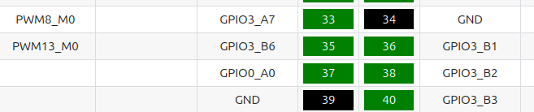
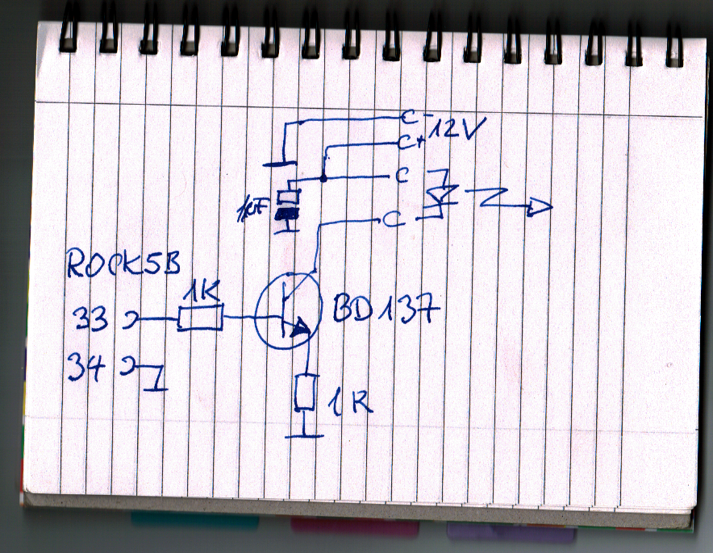

# Rock5 PWM

A C++ class to control PWM on the Rock5B+.

## Prerequsisites

Download from
https://www.armbian.com/rock-5b/
the image "Armbian Minimal / IOT".

Call `armbian-config`:
  - upgrade to Debian "trixie"
  - Make sure you have kernel 6.18.x-current-rockchip64

## PWM motor drivers

Start `sudo nano /boot/armbianEnv.txt`, identify these lines and add/edit them that
they look like these:

```
console=display
overlays=rk3588-pwm13-m0 rk3588-pwm8-m0
```

This enables PWM on
 - pin 33 (channel 1) and,
 - pin 35 (channel 2)
on the 40 pin header.



Create the group `gpio`:

```
groupadd gpio
```
and add yourself and other users to it who want to write to the PWM device.

Copy the file [90-gpio.rules](90-gpio.rules) to `/etc/udev/rules.d/`. This will
make sure that the PWM can be accessed by any user who's in the gpio group.

## Demo program

`pwm_test <channel>`

where channel can be 1 or 2.

```
cmake .
make
./pwm_test 
```

This generates a PWM at 50% duty cycle, then after a keypress 25% and then 75%.

## Example LED driver

Here is an example how to drive a 12V LED light with the BD137
power transistor.



## Credits

- Bernd Porr -  bernd.porr@glasgow.ac.uk
- Yixuan Zha
